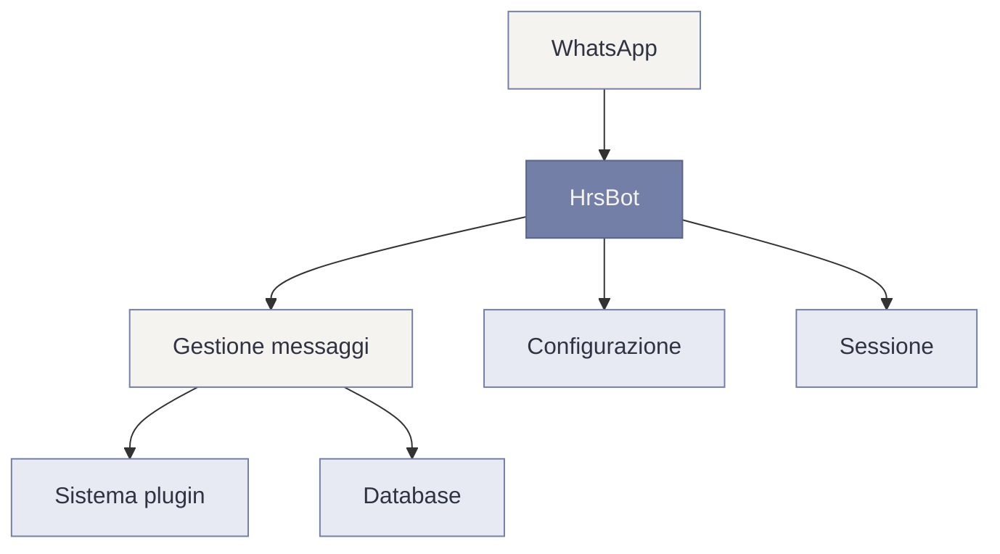

<div align="center">

# HrsBot.

### A WhatsApp bot, powered by JavaScript.

[](https://developer.mozilla.org/docs/Web/JavaScript)
[](https://nodejs.org/)
[](#stato-del-progetto)

[Website](https://github.com/invulnerabile/hrsbot) · [GitHub Repository](https://github.com/invulnerabile/hrsbot)

</div>

---

## 01. Introduzione

**HrsBot** è un bot WhatsApp sviluppato in JavaScript e basato sulla libreria [Baileys](https://www.npmjs.com/package/@itsliaaa/baileys).

Il progetto utilizza un'architettura modulare basata su plugin, progettata per mantenere le funzionalità organizzate e facilitare lo sviluppo e la manutenzione del codice.

> HrsBot è attualmente in fase beta. Il progetto è in evoluzione e alcune funzionalità potrebbero subire modifiche.

## 02. Caratteristiche

- **Architettura modulare** — funzionalità organizzate in plugin indipendenti.
- **Caricamento dinamico** — i plugin vengono caricati dalle rispettive cartelle.
- **Plugin hot reload** — le modifiche ai plugin possono essere rilevate durante l'esecuzione.
- **Connessione flessibile** — collegamento a WhatsApp tramite QR code o codice numerico.
- **Configurazione locale** — le impostazioni personali sono separate dal codice sorgente.

## 03. Requisiti

Per eseguire HrsBot sono necessari:

- [Node.js](https://nodejs.org/)
- npm
- [Git](https://git-scm.com/)
- Un account WhatsApp da collegare.

Si consiglia di utilizzare una versione di Node.js compatibile con le dipendenze del progetto.

## 04. Installazione

Clona il repository:

```bash
git clone https://github.com/invulnerabile/hrsbot.git
```

Entra nella cartella:

```bash
cd hrsbot
```

Installa le dipendenze:

```bash
npm install
```

## 05. Configurazione

Crea il file `config.js` utilizzando il modello `config.js.example`.

Su Linux e macOS:

```bash
cp config.js.example config.js
```

Su Windows, copia il file `config.js.example` e rinomina la copia in `config.js`.

Apri `config.js` e configura almeno il proprietario e il prefisso dei comandi, seguendo la struttura prevista dal modello.

Esempio indicativo:

```js
global.owner = [
    ['39XXXXXXXXXX', 'owner', true]
];

global.prefix = ['.'];
```

Sostituisci il numero di esempio con il tuo numero, comprensivo di prefisso internazionale e senza simboli o spazi.

**Attenzione:** `config.js` contiene impostazioni personali. Non pubblicarlo e non condividere credenziali o dati sensibili.

## 06. Avvio

Avvia il bot:

```bash
npm start
```

Al primo avvio, se non è presente una sessione salvata, sarà possibile scegliere il metodo di collegamento.

### QR Code

1. Seleziona l'opzione `1`.
2. Apri WhatsApp.
3. Vai su **Dispositivi collegati**.
4. Seleziona **Collega un dispositivo**.
5. Scansiona il QR code mostrato nel terminale.

### Codice di collegamento

1. Seleziona l'opzione `2`.
2. Inserisci il numero di telefono con prefisso internazionale.
3. Segui le istruzioni mostrate nel terminale.
4. Inserisci il codice nella procedura di collegamento di WhatsApp.

Dopo il primo collegamento, la sessione viene salvata localmente e potrà essere riutilizzata ai successivi avvii.

Per arrestare il bot, utilizza `Ctrl + C` nel terminale.

## 07. Struttura del progetto

La struttura principale è organizzata in questo modo:

```text
hrsbot/
├── lib/
│   └── ...
├── plugins/
│   └── ...
├── config.js.example
├── handler.js
├── hrs.js
├── package.json
├── package-lock.json
└── README.md
```

| Percorso | Descrizione |
|---|---|
| `lib/` | Moduli di supporto |
| `plugins/` | Plugin e funzionalità del bot |
| `handler.js` | Gestione dei messaggi |
| `hrs.js` | Connessione e avvio del bot |
| `config.js.example` | Modello della configurazione |
| `package.json` | Dipendenze e script |

La struttura può evolvere nel corso dello sviluppo.

## 08. Architettura

Il funzionamento generale può essere rappresentato così:



## 09. File locali

Durante l'esecuzione, HrsBot può utilizzare diversi file e cartelle locali:

| Percorso | Utilizzo |
|---|---|
| `config.js` | Configurazione personale |
| `session/` | Autenticazione WhatsApp |
| `database.json` | Dati persistenti |
| `temp/` | File temporanei |
| `tmp/` | File temporanei |

Questi dati devono rimanere locali e non devono essere pubblicati se contengono informazioni personali o sensibili.

## 10. Sicurezza

- Non condividere la cartella `session/`.
- Mantieni privato il file `config.js`.
- Non condividere QR code o codici di collegamento.
- Controlla il codice dei plugin prima di eseguirli.
- Utilizza soltanto account WhatsApp che sei autorizzato a collegare.

HrsBot utilizza una libreria di terze parti non ufficiale. Eventuali modifiche ai sistemi WhatsApp potrebbero influire sul funzionamento del progetto.

## 11. Stato del progetto

<details>
<summary><strong>Beta — In sviluppo</strong></summary>

HrsBot è un progetto in evoluzione.

Le funzionalità, i plugin e la configurazione possono cambiare nel tempo. Potrebbero essere presenti bug o comportamenti non ancora definitivi.

</details>

## Licenza

La pubblicazione del repository non implica automaticamente una licenza di utilizzo, modifica o ridistribuzione.

Per eventuali autorizzazioni al riutilizzo, fare riferimento alla licenza del progetto, se presente.

---

<div align="center">

**HrsBot.**

<sub>JavaScript · WhatsApp · Modular Architecture</sub>

</div>
