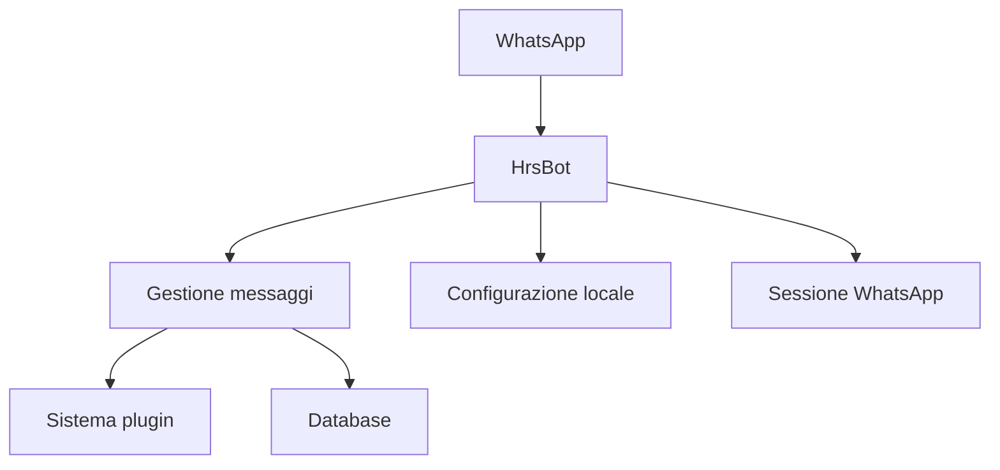

<div align="center">

# HrsBot.

[](https://developer.mozilla.org/docs/Web/JavaScript)
[](https://nodejs.org/)
[](#stato-del-progetto)

[Repository GitHub](https://github.com/invulnerabile/hrsbot) · [Libreria Baileys](https://www.npmjs.com/package/@itsliaaa/baileys)

</div>

---

## Indice

- [Panoramica](#panoramica)
- [Funzionalità](#funzionalità)
- [Requisiti](#requisiti)
- [Installazione](#installazione)
- [Configurazione](#configurazione)
- [Collegamento a WhatsApp](#collegamento-a-whatsapp)
- [Avvio e arresto](#avvio-e-arresto)
- [Struttura del progetto](#struttura-del-progetto)
- [Architettura](#architettura)
- [Dati locali e sicurezza](#dati-locali-e-sicurezza)
- [Risoluzione dei problemi](#risoluzione-dei-problemi)
- [Stato del progetto](#stato-del-progetto)
- [Licenza](#licenza)

## Panoramica

**HrsBot** è un bot WhatsApp scritto in JavaScript e basato su [`@itsliaaa/baileys`](https://www.npmjs.com/package/@itsliaaa/baileys).

Il progetto organizza le funzionalità attraverso plugin JavaScript caricati dalla cartella `plugins/`. È pensato per essere esteso e modificato durante lo sviluppo.

> [!WARNING]
> HrsBot è in beta. Il comportamento, le funzionalità e le dipendenze possono cambiare; non considerarlo software stabile o pronto per ambienti di produzione.

## Funzionalità

- **Architettura a plugin:** le funzionalità sono separate in moduli JavaScript.
- **Caricamento ricorsivo:** il bot cerca i plugin nelle sottocartelle di `plugins/`.
- **Ricaricamento dei plugin:** il processo monitora le modifiche ai file JavaScript dei plugin.
- **Collegamento WhatsApp:** al primo avvio è possibile usare un QR code o un codice di collegamento.
- **Persistenza locale:** sessione e dati del bot sono conservati nella cartella del progetto.

Le funzionalità effettivamente disponibili dipendono dai plugin presenti nella versione installata.

## Requisiti

- Node.js 20 o superiore
- npm
- Git
- Un account WhatsApp che sei autorizzato a collegare

Link utili: [Node.js](https://nodejs.org/) · [Git](https://git-scm.com/)

## Installazione

Clona il repository e installa le dipendenze:

```bash
git clone https://github.com/invulnerabile/hrsbot.git
cd hrsbot
npm install
```

Crea il file di configurazione locale partendo dal modello incluso:

```bash
cp config.js.example config.js
```

Su Windows, copia `config.js.example` e rinomina la copia in `config.js`.

## Configurazione

Apri `config.js` e imposta il proprietario del bot e il prefisso dei comandi. Il file `config.js.example` contiene il modello da seguire.

Esempio:

```js
global.owner = [
    ['39XXXXXXXXXX', 'owner', true]
];

global.prefix = ['.'];
```

Sostituisci `39XXXXXXXXXX` con il numero corretto, comprensivo di prefisso internazionale e senza `+`, spazi o simboli. Puoi personalizzare il prefisso nell'array `global.prefix`.

**Non pubblicare `config.js`.** Mantieni nel repository soltanto il modello privo di credenziali personali.

## Collegamento a WhatsApp

Al primo avvio, se non è presente una sessione salvata, HrsBot chiede quale metodo di collegamento utilizzare.

### QR code

1. Seleziona `1` nel terminale.
2. Apri WhatsApp e vai su **Dispositivi collegati → Collega un dispositivo**.
3. Scansiona il QR code mostrato nel terminale.

### Codice di collegamento

1. Seleziona `2` nel terminale.
2. Inserisci il numero con prefisso internazionale, utilizzando solo le cifre.
3. Segui le istruzioni mostrate nel terminale e completa il collegamento da WhatsApp.

Tratta QR code e codici di collegamento come credenziali: non condividerli con altre persone.

## Avvio e arresto

Dalla cartella del progetto, avvia il bot con:

```bash
npm start
```

Lo script `start` esegue `index.js`, che avvia il processo principale del bot. Per arrestarlo, usa `Ctrl + C` nel terminale.

## Struttura del progetto

```text
hrsbot/
├── lib/                  # Moduli di supporto
├── plugins/              # Plugin e funzionalità
├── banner.js             # Banner iniziale
├── config.js.example     # Modello di configurazione
├── handler.js            # Gestione dei messaggi
├── hrs.js                # Connessione e ciclo del bot
├── index.js              # Avvio del processo
├── package.json          # Dipendenze e script
├── package-lock.json     # Versioni delle dipendenze installate
└── README.md
```

La struttura può cambiare con l'evoluzione del progetto. I plugin sono caricati ricorsivamente dalle sottocartelle di `plugins/`.

## Architettura

Il flusso essenziale del bot è rappresentato qui sotto:



## Dati locali e sicurezza

Durante l'esecuzione, HrsBot può creare o utilizzare file locali, tra cui:

| Percorso | Utilizzo |
| --- | --- |
| `config.js` | Configurazione personale |
| `session/` | Dati di autenticazione WhatsApp |
| `database.json` | Dati persistenti del bot |
| `temp/` e `tmp/` | File temporanei |

Questi file possono contenere dati personali o di autenticazione. Non inserirli nel repository e non condividerli pubblicamente.

- Mantieni privati `config.js` e `session/`.
- Non condividere QR code, codici di collegamento o credenziali.
- Controlla i plugin prima di eseguirli, in particolare quelli che modificano gruppi o messaggi.
- Utilizza soltanto account WhatsApp che sei autorizzato a collegare.
- Ricorda che Baileys è una libreria di terze parti non ufficiale: modifiche a WhatsApp possono interrompere il funzionamento.

## Risoluzione dei problemi

**Il bot chiede di collegare nuovamente WhatsApp**

Controlla che la cartella `session/` esista e che il dispositivo sia ancora collegato nelle impostazioni di WhatsApp. Non eliminare la sessione, a meno che tu non voglia effettuare di nuovo il collegamento.

**Un plugin non viene caricato**

Controlla gli errori nel terminale e verifica che il plugin esporti l'handler nel formato previsto dal progetto.

**La connessione fallisce o si riavvia**

Verifica la connessione a Internet, la versione di Node.js e gli errori riportati nel terminale. La compatibilità con WhatsApp Web può cambiare indipendentemente dal progetto.

## Stato del progetto


HrsBot è in sviluppo. Funzionalità e interfacce possono cambiare e potrebbero essere presenti bug.

## Licenza

Il repository attualmente non concede una licenza di riutilizzo. La disponibilità pubblica del codice non implica automaticamente il permesso di copiarlo, modificarlo o ridistribuirlo.

---

<div align="center">

**HrsBot.**

<sub>JavaScript · WhatsApp · Modularità</sub>

</div>